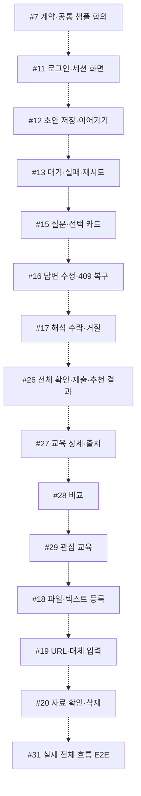
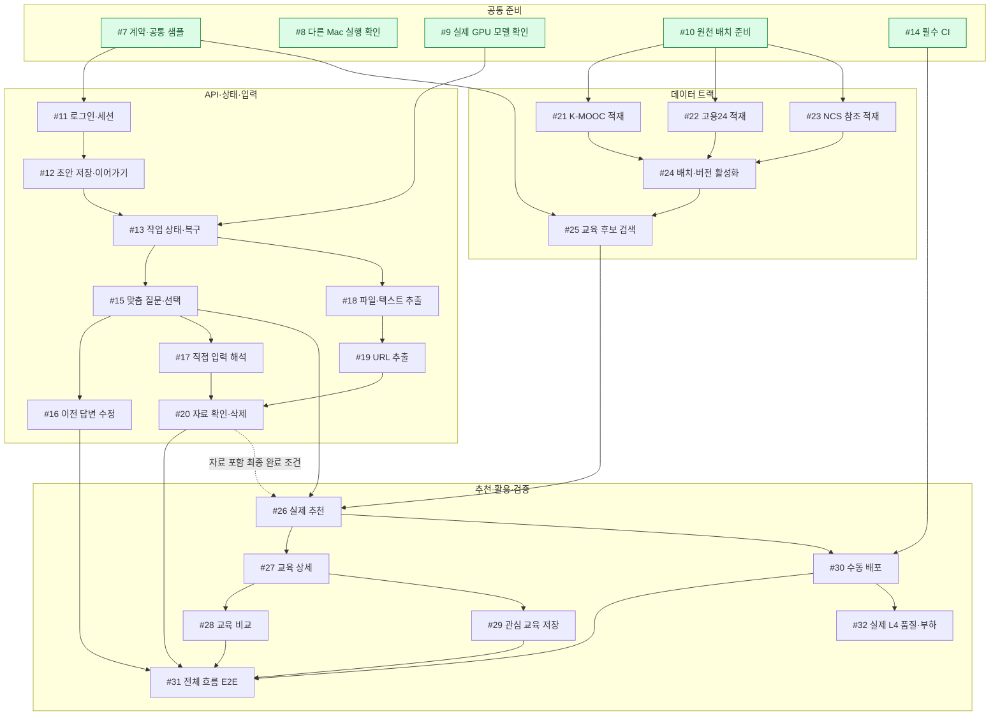

# 프론트·백엔드 착수 공정도

[문서 안내](../README.md) · [전체 이슈](issues.md) · [개발 공정 보드](https://github.com/orgs/today-tommorrow/projects/1)

2026-11-01 등록된 26개 이슈 기준. 확인 시 닫힌 이슈는 0개입니다. 이 문서는 작업 순서이며 구현 완료를 뜻하지 않습니다. 최신 상태는 연결된 이슈에서 확인합니다.

## 지금 배정할 일

| 담당 | 지금 시작 | 그다음 |
| --- | --- | --- |
| A 프론트 | **#7**: 성공·빈 결과·오류 샘플과 화면/API 타입 합의 | #8의 다른 실제 Mac 실행 확인에 참여 → #11 로그인 화면 → #12 초안 화면 → #13 대기/실패 UI → #15 질문 카드 |
| B 백엔드 | **#7**: 인증·슬롯·revision·멱등·모델 입출력 계약 확정 | #11 인증 → #12 프로필/초안 → #13 jobs/복구 → #15 질문/답변 트랜잭션 |
| C AI | **#9**: 실제 L4 모델 실행·버전 확인; #7 모델 계약 합의 참여 | #15 질문 생성 → #17 직접 입력 해석 → #26 추천 |
| D 데이터·인프라 | **#14**: CI 구현, 자동 배포·자동 승인 제외 | #10 원천 배치 → #21/#22/#23 적재 → #24 활성화 → #25 검색 → #18/#19 자료 추출 |

**4명 기준 권장 배정입니다.** #8은 구현자 외 팀원의 실제 Mac 검증이며 전체 기능 개발을 멈추는 선행 작업은 아닙니다. #14와 #10은 기술적으로 독립적이지만 같은 D가 맡으면 CI를 먼저 처리합니다. 3명이면 A=프론트, B=API·DB·자료, C=AI·데이터로 묶고 #14 운영 담당을 한 명 정합니다. C에게 모델과 데이터 작업을 동시에 전담시키지 말고 원천 최소 적재 후 모델 작업으로 이동합니다.

#7은 문서를 정리한 것만으로 끝나지 않습니다. D01·D02·D04·D05 계약과 공통 샘플을 합의해야 후속 구현이 안전합니다. 로그인에는 OAuth 설정, #9에는 실제 GPU 접근, #10에는 사용 가능한 원천 자료가 필요합니다.

## 프론트: API를 기다리지 않는 구현 순서

점선은 **한 프론트 담당자의 권장 작업 순서**입니다. 서버 기능의 필수 의존성을 뜻하지 않습니다. #7에서 해당 기능 계약을 합의하면 합성 fixture로 화면 개발을 먼저 시작할 수 있습니다. 화면 PR은 `Refs`, 실제 API·모델까지 확인한 최종 PR만 `Closes`를 사용합니다.

추천 화면을 자료 화면보다 먼저 만드는 것은 **자료 없는 실제 추천을 일찍 연결하기 위한 순서**입니다. 자료 기능은 제외하지 않습니다. #26 전체 완료에는 #20 자료 확인까지 필요하므로 앞부분 통합만으로 닫지 않습니다. 다른 프론트 담당자가 있으면 결과 화면과 자료 화면을 나누되 App·공통 스타일 소유자는 한 명으로 둡니다.

| 프론트가 실제 연동할 기능 | 필요한 서버·AI·데이터 준비 |
| --- | --- |
| #11 로그인 | #7 계약 + #11 인증 API/OAuth |
| #12 초안 | #11 인증 + #12 저장/재조회 API |
| #13 대기/복구 | #9 모델 + #12 초안 + #13 jobs/Worker |
| #15 질문·#16 수정·#17 해석 | #15 실제 질문 경로, 이후 각 이슈 API·AI 작업 |
| #26 추천 결과 | #12·#13·#15·#25 + #26 API/실제 모델; 전체 완료에는 #20 추가 |
| #27 상세·#28 비교·#29 관심 | #24 카탈로그 + #26 추천 경로 + 각 기능 API; #29는 #11 인증도 필요 |
| #18 파일·#19 URL·#20 자료 확인 | #12·#13 기반; #19는 #18, #20은 #17·#18·#19 필요 |
| #31 E2E | 아래 정확한 선행표 + #30 실제 배포; 목 응답만으로 완료 불가 |

## 백엔드: 실제 통합 선행 관계

실선은 **실제 통합에 필요한 선행 관계**입니다. 화살표가 여러 개 들어오면 모두 필요합니다. 코드 작성 자체를 선행 이슈가 닫힐 때까지 금지하는 뜻은 아닙니다. 같은 계약으로 분리 구현하고 선행 변경이 합쳐진 뒤 통합 검증합니다. 중복 경로는 줄였고, 등록된 직접 선행은 아래 표에 전부 적었습니다.

#21·#22·#23은 서로 독립적입니다. 담당자가 한 명이면 순서대로 진행하고, 나눌 사람이 있을 때만 병렬로 진행합니다. #15 이후 #16·#17·#18도 기능상 분기할 수 있지만 같은 API 트랜잭션·migration·공용 라우터 파일은 B가 조정합니다.

**가장 먼저 연결할 제품 흐름:** #7 → #11 → #12 → #13 → #15 → #26. #13에는 #9 실제 모델 준비, #26에는 #25 실제 검색 준비가 함께 필요합니다. #20까지 합쳐 자료 포함 경로를 확인한 후 #26을 닫습니다.

## 정확한 선행표 — 착수할 이슈만 찾기

독립 착수 항목은 선행이 없는 #7·#8·#9·#10·#14입니다. 아래 선행은 등록된 이슈 기준이며 실제 담당자 일정은 별도입니다.

| 이슈 | 작업 | 실제 통합 선행 | 최종 완료 추가 조건 |
| --- | --- | --- | --- |
| [#7](https://github.com/today-tommorrow/today-tommorrow/issues/7) | 계약·공통 샘플 | **없음 — 바로 착수** | — |
| [#8](https://github.com/today-tommorrow/today-tommorrow/issues/8) | 다른 Mac 실행 확인 | **없음 — 바로 착수** | — |
| [#9](https://github.com/today-tommorrow/today-tommorrow/issues/9) | 실제 GPU 모델 확인 | **없음 — 바로 착수** | — |
| [#10](https://github.com/today-tommorrow/today-tommorrow/issues/10) | 원천 배치 준비 | **없음 — 바로 착수** | — |
| [#11](https://github.com/today-tommorrow/today-tommorrow/issues/11) | 로그인·세션 | [#7](https://github.com/today-tommorrow/today-tommorrow/issues/7) | — |
| [#12](https://github.com/today-tommorrow/today-tommorrow/issues/12) | 초안 저장·이어가기 | [#7](https://github.com/today-tommorrow/today-tommorrow/issues/7), [#11](https://github.com/today-tommorrow/today-tommorrow/issues/11) | — |
| [#13](https://github.com/today-tommorrow/today-tommorrow/issues/13) | 작업 상태·복구 | [#7](https://github.com/today-tommorrow/today-tommorrow/issues/7), [#9](https://github.com/today-tommorrow/today-tommorrow/issues/9), [#12](https://github.com/today-tommorrow/today-tommorrow/issues/12) | — |
| [#14](https://github.com/today-tommorrow/today-tommorrow/issues/14) | 필수 CI | **없음 — 바로 착수** | — |
| [#15](https://github.com/today-tommorrow/today-tommorrow/issues/15) | 맞춤 질문·선택 | [#7](https://github.com/today-tommorrow/today-tommorrow/issues/7), [#9](https://github.com/today-tommorrow/today-tommorrow/issues/9), [#12](https://github.com/today-tommorrow/today-tommorrow/issues/12), [#13](https://github.com/today-tommorrow/today-tommorrow/issues/13) | — |
| [#16](https://github.com/today-tommorrow/today-tommorrow/issues/16) | 이전 답변 수정 | [#12](https://github.com/today-tommorrow/today-tommorrow/issues/12), [#15](https://github.com/today-tommorrow/today-tommorrow/issues/15) | — |
| [#17](https://github.com/today-tommorrow/today-tommorrow/issues/17) | 직접 입력 해석 | [#12](https://github.com/today-tommorrow/today-tommorrow/issues/12), [#13](https://github.com/today-tommorrow/today-tommorrow/issues/13), [#15](https://github.com/today-tommorrow/today-tommorrow/issues/15) | — |
| [#18](https://github.com/today-tommorrow/today-tommorrow/issues/18) | 파일·텍스트 추출 | [#7](https://github.com/today-tommorrow/today-tommorrow/issues/7), [#12](https://github.com/today-tommorrow/today-tommorrow/issues/12), [#13](https://github.com/today-tommorrow/today-tommorrow/issues/13) | — |
| [#19](https://github.com/today-tommorrow/today-tommorrow/issues/19) | URL 추출 | [#12](https://github.com/today-tommorrow/today-tommorrow/issues/12), [#13](https://github.com/today-tommorrow/today-tommorrow/issues/13), [#18](https://github.com/today-tommorrow/today-tommorrow/issues/18) | — |
| [#20](https://github.com/today-tommorrow/today-tommorrow/issues/20) | 자료 확인·삭제 | [#17](https://github.com/today-tommorrow/today-tommorrow/issues/17), [#18](https://github.com/today-tommorrow/today-tommorrow/issues/18), [#19](https://github.com/today-tommorrow/today-tommorrow/issues/19) | — |
| [#21](https://github.com/today-tommorrow/today-tommorrow/issues/21) | K-MOOC 적재 | [#10](https://github.com/today-tommorrow/today-tommorrow/issues/10) | — |
| [#22](https://github.com/today-tommorrow/today-tommorrow/issues/22) | 고용24 적재 | [#10](https://github.com/today-tommorrow/today-tommorrow/issues/10) | — |
| [#23](https://github.com/today-tommorrow/today-tommorrow/issues/23) | NCS 참조 적재 | [#10](https://github.com/today-tommorrow/today-tommorrow/issues/10) | — |
| [#24](https://github.com/today-tommorrow/today-tommorrow/issues/24) | 배치·버전 활성화 | [#21](https://github.com/today-tommorrow/today-tommorrow/issues/21), [#22](https://github.com/today-tommorrow/today-tommorrow/issues/22), [#23](https://github.com/today-tommorrow/today-tommorrow/issues/23) | — |
| [#25](https://github.com/today-tommorrow/today-tommorrow/issues/25) | 교육 후보 검색 | [#7](https://github.com/today-tommorrow/today-tommorrow/issues/7), [#21](https://github.com/today-tommorrow/today-tommorrow/issues/21), [#22](https://github.com/today-tommorrow/today-tommorrow/issues/22), [#23](https://github.com/today-tommorrow/today-tommorrow/issues/23), [#24](https://github.com/today-tommorrow/today-tommorrow/issues/24) | — |
| [#26](https://github.com/today-tommorrow/today-tommorrow/issues/26) | 실제 추천 | [#12](https://github.com/today-tommorrow/today-tommorrow/issues/12), [#13](https://github.com/today-tommorrow/today-tommorrow/issues/13), [#15](https://github.com/today-tommorrow/today-tommorrow/issues/15), [#25](https://github.com/today-tommorrow/today-tommorrow/issues/25) | [#20](https://github.com/today-tommorrow/today-tommorrow/issues/20) |
| [#27](https://github.com/today-tommorrow/today-tommorrow/issues/27) | 교육 상세 | [#24](https://github.com/today-tommorrow/today-tommorrow/issues/24), [#26](https://github.com/today-tommorrow/today-tommorrow/issues/26) | — |
| [#28](https://github.com/today-tommorrow/today-tommorrow/issues/28) | 교육 비교 | [#27](https://github.com/today-tommorrow/today-tommorrow/issues/27) | — |
| [#29](https://github.com/today-tommorrow/today-tommorrow/issues/29) | 관심 교육 저장 | [#11](https://github.com/today-tommorrow/today-tommorrow/issues/11), [#24](https://github.com/today-tommorrow/today-tommorrow/issues/24), [#27](https://github.com/today-tommorrow/today-tommorrow/issues/27) | — |
| [#30](https://github.com/today-tommorrow/today-tommorrow/issues/30) | 수동 배포 | [#11](https://github.com/today-tommorrow/today-tommorrow/issues/11), [#13](https://github.com/today-tommorrow/today-tommorrow/issues/13), [#14](https://github.com/today-tommorrow/today-tommorrow/issues/14), [#26](https://github.com/today-tommorrow/today-tommorrow/issues/26) | — |
| [#31](https://github.com/today-tommorrow/today-tommorrow/issues/31) | 전체 흐름 E2E | [#16](https://github.com/today-tommorrow/today-tommorrow/issues/16), [#17](https://github.com/today-tommorrow/today-tommorrow/issues/17), [#20](https://github.com/today-tommorrow/today-tommorrow/issues/20), [#26](https://github.com/today-tommorrow/today-tommorrow/issues/26), [#27](https://github.com/today-tommorrow/today-tommorrow/issues/27), [#28](https://github.com/today-tommorrow/today-tommorrow/issues/28), [#29](https://github.com/today-tommorrow/today-tommorrow/issues/29), [#30](https://github.com/today-tommorrow/today-tommorrow/issues/30) | — |
| [#32](https://github.com/today-tommorrow/today-tommorrow/issues/32) | 실제 L4 품질·부하 | [#9](https://github.com/today-tommorrow/today-tommorrow/issues/9), [#15](https://github.com/today-tommorrow/today-tommorrow/issues/15), [#25](https://github.com/today-tommorrow/today-tommorrow/issues/25), [#26](https://github.com/today-tommorrow/today-tommorrow/issues/26), [#30](https://github.com/today-tommorrow/today-tommorrow/issues/30) | — |

## 맡은 이슈 실행 규칙

1. #7의 공통 샘플로 웹·API·AI 계약을 맞추고 해당 이슈의 영역별 체크박스만 맡습니다. 같은 시나리오에 프론트/백엔드 중복 이슈를 만들지 않습니다.
2. 최신 main에서 영역별 브랜치를 만듭니다. 예: `feat/web/11-login`, `feat/api/11-login`. 공용 파일 경계는 [Phase 문서](phases.md)를 따릅니다.
3. 중간 PR은 `Refs #11`, 실제 시나리오 전체를 검증한 마지막 PR만 `Closes #11`. 계약·DB 변경은 관련 담당자 리뷰와 migration 적용/재조회 증거를 남깁니다.
4. CI는 필수. xifoxy-ru·zxcv718 중 작성자가 아닌 사람에게 리뷰를 요청하고 사람 1명 이상 승인 후 Squash and merge합니다. 자동 배포·자동 승인은 제외합니다.
